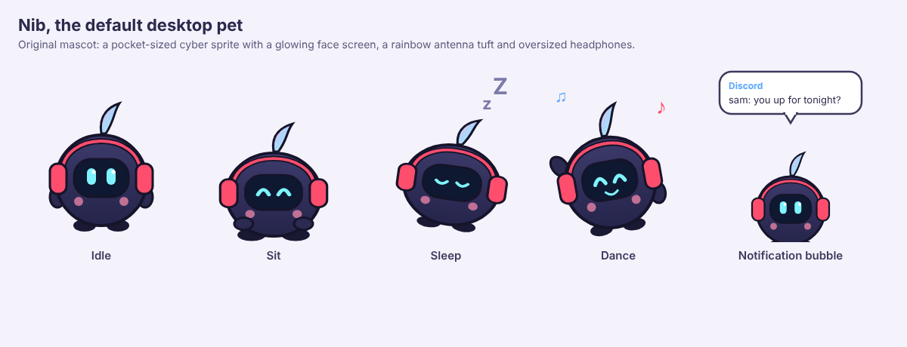

# desknib

A quiet desktop pet that lives in the corner of your screen. It is meant to be
light (about 9 MB of RAM and under 1% CPU) and never annoying: no sounds, no
focus stealing, and clicks pass straight through everything except the pet.



## Status

Milestone 1 of the plan: Nib idles on the desktop, talks in chat bubbles, and
can be dragged around. Linux (X11 and XWayland) first; Windows comes later.

| Milestone | What | State |
| --- | --- | --- |
| 1 | Transparent always-on-top pet, idle animation, click bubble, drag, tray | done |
| 2 | Sit, stretch and sleep driven by desk idle time | next |
| 3 | Desktop notifications shown as bubbles instead of popups | planned |
| 4 | Dance while music or video plays (MPRIS) | planned |
| 5 | Character pack loader UI, more characters | planned |

## Run

```sh
cargo run --release
```

Options: `--character <dir>` loads a character pack, `--quiet` starts in quiet
mode (no unprompted bubbles), `--help` lists everything.

| Action | Result |
| --- | --- |
| Left-click Nib | Nib says something |
| Drag Nib | Moves the pet |
| Right-click twice | Quit |
| Tray icon | Say hi, Quiet mode, Hide pet, Quit |

The tray uses the StatusNotifierItem protocol, which Cinnamon, KDE and XFCE
support out of the box (GNOME needs the AppIndicator extension). Without a tray
the pet still works; quit with a double right-click.

Transparency needs a compositing window manager, which Cinnamon, KDE, GNOME
and XFCE (with compositing on) all provide.

## Character packs

A pack is a folder with a `character.json` and one PNG strip per animation:

```json
{
  "name": "Nib",
  "author": "desknib contributors",
  "license": "CC-BY-4.0",
  "scale": 1.0,
  "bubble_anchor": [84, 40],
  "animations": {
    "idle": { "file": "idle.png", "frames": 8, "fps": 6 },
    "sleep": { "file": "sleep.png", "frames": 4, "fps": 2 }
  }
}
```

- Each strip is frames laid side by side; its width must divide evenly by
  `frames`, and every animation must use the same frame size.
- `idle` is required. Missing animations (`sit`, `sleep`, `dance`) fall back to it.
- `bubble_anchor` is the point, in frame pixels, the bubble tail points at.
- File names must be plain names inside the pack folder.

Nib's own pack lives in [`characters/nib`](characters/nib) and is compiled into
the binary. Its source art is [`tools/nib-art/nib.html`](tools/nib-art/nib.html);
`tools/nib-art/render.sh` re-renders the strips with headless Chromium.

Please only share packs of characters you have the rights to.

## Licenses

- Code: MIT, see [LICENSE](LICENSE).
- Nib artwork: CC-BY-4.0.
- Bundled DejaVu Sans fonts: see [assets/fonts/DEJAVU-LICENSE.txt](assets/fonts/DEJAVU-LICENSE.txt).

desknib runs fully offline and never sends anything anywhere.
